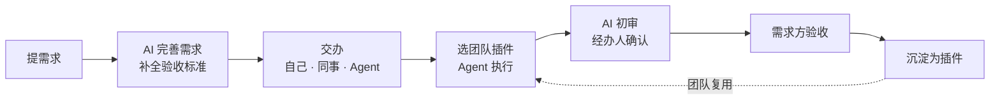

[English](README.md) · **简体中文**

> **中文文档入口：[文档目录](docs/README.zh-CN.md) · [安装与启动](docs/getting-started.md) · [开发指南](docs/development.md)**

<div align="center">


# SoduWork

## 企业级 AI 原生引擎

**数字 AI 员工，先有数字方法论：沉淀团队最佳实践，驱动多岗位、多 Agent 接力与协同。**

**多底座 · 多 Agent · 私有化部署**

支持 Pi · OpenCode · DeepSeek Harness · Qwen Code · Kimi Code · Codex Harness · Codex · Claude Code · Google Harness²

```sh
git clone https://github.com/mdiri-ai/SoduWork
cd SoduWork
```

| 系统 | 启动命令 |
| --- | --- |
| macOS / Linux | `sh start.sh --desktop` |
| Windows PowerShell | `.\start.cmd --desktop` |
| Windows 命令提示符 | `start.cmd --desktop` |

[官网](https://soduwork.ai) | [在线体验](https://soduwork.ai) | [中文文档](docs/README.zh-CN.md) | [在线文档](https://dev.soduwork.ai/zh-CN/) | [Releases](https://github.com/mdiri-ai/SoduWork/releases) | [Discord](https://discord.gg/AXYNrAYHy)

[](LICENSE)
[](https://github.com/mdiri-ai/SoduWork/releases)
[](#快速开始)
[](https://discord.gg/AXYNrAYHy)

</div>

---

## SoduWork 能为你做什么

| | |
| --- | --- |
| **一个 Harness 执行，另一个 Harness 审核** | 可选择 Pi 负责执行，OpenCode 搭配另一个模型对照验收标准复核；复核不通过，带着原因退回重做。 |
| **需求直接交给同事的 Agent 执行** | AI 原生组织人机协同：你提需求、AI 写清验收标准，交办给自己或同事；执行人的 Agent 完成和自审，最后由人验收。谁做了哪一步，相关的人都看得到。 |
| **个人经验变成团队资产** | 和 AI 一起把任务做好，在对话里直接沉淀为插件；团队审核后人人可用、可贡献迭代，全员按需授权。 |

## 核心理念

<table>
<tr>
<td width="33%" valign="top">

**🔀 调度智能**

**选对 Harness 和模型，让合适的 AI 做合适的事。**

- 每个步骤各选 Harness，同一会话随时切换
- 常规步骤用经济型或本地模型，关键步骤用能力更强的模型
- 长任务交给自己的云端执行机继续

</td>
<td width="33%" valign="top">

**🛡️ 治理闭环**

**谁能用什么 AI、在哪台机器上做什么，由组织决定。**

- 插件先审核再共享，可按部门或成员授权、随时撤回
- 部门角色、用量成本和审计日志都有记录
- 支持私有化部署

</td>
<td width="33%" valign="top">

**✅ 结果交付**

**先定标准再动手，需求方验收才算完成。**

- 需求在开工前写明验收标准
- 独立的 AI 初审逐条对照检查
- 最终由人确认

</td>
</tr>
</table>

## 快速开始

> SoduWork 处于公开测试阶段，欢迎试用并反馈；用于生产环境前请先充分评估。

准备好 Python 3.12+、Node.js 22.19+ 和 Git，两条命令跑起来：

在克隆后的目录里，macOS/Linux 运行 `sh start.sh --desktop`，Windows PowerShell 运行 `.\start.cmd --desktop`，命令提示符运行 `start.cmd --desktop`。

首次运行会自动安装依赖，在本机同时启动 Hub、管理端和桌面客户端。按提示为 `admin` 账号设置密码（12–128 位）。然后在管理端 **模型目录** 里接入模型服务，回到客户端新建对话，试一个小任务。Pi 已内置，开箱可用。

### 已经添加 API Key，接下来怎么用？

1. **再添加一个对话模型。** 在管理端「能力配置 → 模型目录」找到刚接入的服务，点「加模型」，填写服务商给出的准确模型 ID，选择「对话模型」并保存。API Key 是服务凭据，单独保存它不会创建可用模型。
2. **打开桌面客户端并登录同一个 Hub。** 源码启动使用 `--desktop`；浏览器管理端用于配置。核对登录页「连接」里的地址与刚才保存模型的管理端一致。
3. **点「新对话」，选择 Pi 和刚添加的模型。** Pi 使用 SoduWork 模型目录；Codex、Claude Code 等使用自己账号的底座还需要各自的登录，不会自动使用这把 API Key。
4. **发一条小任务验证。** 例如：「把下面的模拟会议记录整理成待办表，列出负责人和截止时间；没有给出的信息写待确认：小王负责整理需求，周五完成；小李核对报价。」收到回复后检查表格内容。
5. **需要交办与验收时再创建需求。** 写清目标、材料和验收标准，打开需求的「安排执行」，选择 Agent 和模型，检查交付结果后再确认验收。普通对话不需要先创建项目、插件或自动化。

第一条消息建议使用 **OpenAI 兼容协议的对话模型 + Pi**。连接测试成功只表示探测通过，实际消息仍可能受到余额、模型权限或协议限制。底座列表为空时先检查「Agent 管理」的就绪状态及 Runner 连接；模型列表为空时核对模型是否已添加、启用，以及两端 Hub 地址是否一致。

完整字段说明、操作步骤和错误排查见[从零运行：发出第一条 AI 消息](docs/getting-started.md#发出第一条-ai-消息)。

<details>
<summary><b>在线体验</b></summary>

从 [Releases](https://github.com/mdiri-ai/SoduWork/releases) 下载客户端，在登录页的 **连接** 里填入体验地址 `https://soduwork.ai`，注册并登录即可。

> 体验环境仅用于评估，请勿上传真实业务数据或任何敏感信息。

</details>

<details>
<summary><b>安装桌面客户端</b></summary>

| 系统 | 安装包 |
| --- | --- |
| Windows | `SoduWork-<version>-Setup.exe` |
| macOS（Apple 芯片 / Intel） | `SoduWork-<version>-mac-<arch>.dmg` |
| Linux | `SoduWork-<version>-linux.deb` / `.rpm` / `.tar.gz` |

从 [Releases](https://github.com/mdiri-ai/SoduWork/releases) 下载。首次启动时在 **连接** 里填入你的 Hub 地址并登录。macOS 提示"无法验证开发者"时，到 **系统设置 → 隐私与安全性** 点 **仍要打开**。

</details>

<details>
<summary><b>团队部署（Docker）</b></summary>

装好并启动 Docker 后，在仓库根目录运行：

```bash
python3 ops/self-host/deploy.py up
python3 ops/self-host/deploy.py credentials   # 查看初始管理员密码
```

一台服务器即可启动 Hub、管理端和 PostgreSQL；前面加一层 HTTPS 反向代理，就能开放给团队使用。详见[用 Docker 自部署](https://dev.soduwork.ai/zh-CN/docs/get-started/docker)和[团队部署](https://dev.soduwork.ai/zh-CN/docs/deploy)。

</details>

端口、数据目录和常见问题排查，见[从源码启动](https://dev.soduwork.ai/zh-CN/docs/get-started/run-from-source)和[常见问题](https://dev.soduwork.ai/zh-CN/docs/get-started/faq)。

## SoduWork 能解决什么？

把数字员工发给每一个人，只是 AI 原生的第一步。**教会它按我们的方法做事，让它与多岗位、多 Agent 配合好**，才是落地的关键。很多人和团队通常卡在四个地方：

| 遇到的问题 | SoduWork 的做法 |
| --- | --- |
| **AI 做得快，检查太困难**<br>无法判断 AI 做得对不对，省下的时间又花在了核对上 | **需求即标准，交付带验收**<br>开工前写清验收标准，AI 逐条初审、人最终确认；没执行的检查不算通过 |
| **对话做完了，方法没留下**<br>做法和踩过的坑只在一个人的对话记录里，下次遇到类似任务或者换了人，又得从头来 | **先把事做对，再沉淀插件**<br>和 AI 一起把事做对一次，在对话里直接沉淀为插件；团队审核后共用，改进一次，全员同步 |
| **AI 的产出进不了协作流程**<br>内容越产越多，却靠复制粘贴和群消息交接，每次还要重讲背景 | **先建需求，再人机接力**<br>需求、上下文和进展随需求流转；人和 Agent 接手即用，谁做了哪一步全程可查 |
| **最懂业务的人，没法自己建 Agent**<br>现有 Agent 平台多靠技术人员定制，还和特定模型、Harness 绑定，升级困难 | **业务人员也能沉淀方法，Harness 和模型自由调度**<br>用自然语言描述做法，沉淀为插件；多种 Harness、多种模型按需组合，随时更换，无需重建 |

## 工作方式

需求、执行、验收和沉淀，都在同一个需求池里流转：



| 谁 | 怎么用 |
| --- | --- |
| **个人开发者、OPC** | 一个人带一支 Agent 团队：需求放进需求池，多个 Agent 接力完成，自己只做验收 |
| **专业人员、业务骨干** | 把做法变成团队资产：和 AI 一起把事做成，沉淀为插件，审核后发布到团队目录，持续迭代 |
| **管理人员、需求方** | 提需求、交办、验收：AI 补全验收标准，交给人或 Agent；经办人选用团队插件完成并自审，最后由你验收 |
| **团队新人** | 用团队经验把事情做对：选用组织沉淀的插件资产，按团队标准完成；发现问题，直接改进并提交更新 |

谁提的、谁做的、用了哪个插件、谁批准的，都留有记录。

## 多 Harness · 多 Agent 协同

**Harness** 是实际执行任务的 Agent 运行时，不是模型。SoduWork 通过统一的 Harness 适配接口接入各个 Harness，上层的需求、插件和验收流程不依赖任何一个 Harness。同一会话中可以随时切换 Harness，对话记录和工作目录都保留；支持 Agent Client Protocol（ACP）的程序，登记一条目录声明即可接入。

<details>
<summary>已支持的 9 种 Harness</summary>

| Harness | 使用的模型 | 接入方式 |
| --- | --- | --- |
| Pi | SoduWork 模型目录里的模型 | 默认内置 |
| OpenCode | SoduWork 模型目录里的模型 | 原生适配，按需安装 |
| DeepSeek Harness | SoduWork 模型目录里的模型，或自有 DeepSeek Key | ACP，按需安装 |
| Qwen Code | SoduWork 模型目录里的模型 | ACP，按需安装 |
| Kimi Code | SoduWork 模型目录里的模型 | ACP，按需安装 |
| Codex Harness | SoduWork 模型目录里的模型 | ACP，按需安装 |
| Codex | 自己的 OpenAI 账号 | 原生适配，按需安装 |
| Claude Code | 自己的 Anthropic 账号 | ACP 适配，官方安装程序 |
| Google Harness² | SoduWork 模型目录里的模型 | 原生适配；核心随包内置，首次使用时准备 |

</details>

**多 Agent 在不同层面协同：**

| 层面 | 由谁决定 | 举个例子 |
| --- | --- | --- |
| Harness | Harness 自己 | OpenCode、Qwen Code 自行派出子 Agent，分头探索代码、拆分任务 |
| 单个方法 | 插件或 Skill 规定方法、流程、规则和完成标准 | 复核插件规定要查哪些项、附哪些证据 |
| 组合方法 | 插件工作流为每一步指定 Harness、Skill 和模型 | Pi 起草，Qwen Code 核对来源，核对不通过就停下 |
| 人与人/Agent | 需求方和经办人/执行 Agent | 需求交给同事，同事的 Agent 完成，需求方验收 |
| 并行 | Hub | 不同需求同时交给不同的 Agent，也可以放到云端执行机上 |

步骤之间、人与人之间，工作按插件和经办人的安排流转，Agent 不会自行把工作转交给其他 Agent。

## 插件与即用

技能（Skill）告诉 AI 怎么做，智能体把 AI 包装成助手；SoduWork 的插件和即用应用，把团队跑通的做法变成**可执行、可验收、可迭代、可治理**的方法。

| | 技能（Skill） | 智能体（Agent） | SoduWork 插件 | SoduWork 即用 |
| --- | :---: | :---: | :---: | :---: |
| **形态** | 方法说明，AI 读取后执行 | 提示词、知识库、工具或平台流程的组合 | 带版本的能力包：方法、参数、验收标准、工作流 | 插件 + 专用工作界面，右侧自带 AI 对话 |
| **用途** | 单点方法 | 单类任务助手 | 团队标准作业，AI 执行 | 高频界面化作业，AI 互动 |
| **调用** | AI 自动读取 | Agent 平台内调用 | `/` 调用 · 跟随需求 · 关联自动化 | 独立窗口 + AI 侧栏 |
| **按工序执行** | ✗ | ◐ | ✓ | ✓ |
| **指定和切换 Harness** | ✗ | ◐ | ✓ | ✓ |
| **验收标准 + AI 初审 + 人工确认** | ✗ | ◐ | ✓ | ✓ |
| **版本** | ✗ | ◐ | ✓ | ✓ |
| **界面和交互** | ✗ | ◐ 对话 | ◐ 对话 | ✓ |
| **审核、授权、撤回** | ◐ 可配 | ◐ 可配 | ✓ | ✓ |

<sub>✓ 支持　◐ 部分支持　✗ 不支持。"智能体"指在常见 Agent 平台上构建的助手，能力因平台而异。</sub>

**从个人到团队**：对话中生成或沉淀插件 → 本机预检并试用 → 自己用，或提交审核、发布到团队目录。个人使用轻量上手；团队共享增加审核、授权和版本管理。

<details>
<summary>示例：对照来源核对的周报插件</summary>

```json
{
  "schemaVersion": 1,
  "key": "weekly-brief",
  "version": "1.0.0",
  "name": "Weekly brief",
  "workflow": {
    "nodes": [
      { "key": "draft", "type": "ai", "config": { "agentKind": "local:pi", "prompt": "Write deliverables/brief.md from this week's tasks." } },
      { "key": "check", "type": "ai_review", "dependsOn": ["draft"],
        "config": { "agentKind": "local:qwen", "prompt": "Check each claim against the sources. Block if any claim has no source." } },
      { "key": "done", "type": "publish", "dependsOn": ["check"] }
    ]
  }
}
```

</details>

插件不用手写：在输入框输入 `/`，选择 **插件开发助手**，把工作讲清楚，它会生成插件文件。详见[插件指南](https://dev.soduwork.ai/zh-CN/docs/plugins)和[即用](https://dev.soduwork.ai/zh-CN/docs/apps)。

## 与同类 Agent 产品的区别

- **相比低代码 Agent 平台**：不用先画节点、配流程，做成一件事就能沉淀为插件；Agent 在本机或云端直接处理真实的文件和工程。
- **相比编程 Agent Harness**：SoduWork 不替代它们，而是把它们作为 Harness 接进团队工作台，补上需求流转、执行与验收闭环，以及独立 AI 审查、插件审核分发和权限审计。
- **相比多 Agent 编排平台**：工序和检查点由人设定，交付凭证据、由需求方验收；工作在步骤之间、人与人之间按插件和经办人的安排流转。
- **相比 AI 办公助手**：经验不留在个人会话里，而是沉淀为经团队审核、有版本、可复用的插件。

<details>
<summary>能力对比表</summary>

| 能力 | 低代码 Agent 平台 | 编程 Agent Harness | 多 Agent 编排平台 | AI 办公助手 | SoduWork |
| --- | :---: | :---: | :---: | :---: | :---: |
| 业务人员对话式构建与迭代 Agent | ◐ | — | — | ◐ | ✓ |
| 覆盖研发与非研发的通用工作 | ✓ | ◐ | ◐ | ✓ | ✓ |
| 多 Harness 与多模型按需组合 | ◐ | — | ✓ | — | ✓ |
| 需求内置验收标准，交付凭证据验收 | — | — | ◐ | — | ✓ |
| 插件审核发布与分级授权治理 | ◐ | — | — | ◐ | ✓ |
| 企业级生产与团队协同 | ◐ | ✓ | ◐ | ◐ | ✓ |
| 开箱即用，无需自建业务层 | — | ✓ | — | ✓ | ✓ |
| 托管服务 | ✓ | ◐ | ◐ | ✓ | ◐ 私有化部署 |

<sub>✓ 支持　◐ 部分支持或因产品而异　— 不支持。按各类产品的常见形态归纳。</sub>

</details>

## 架构概览

**这些难题，SoduWork 已经处理好：**

| 难题 | SoduWork 怎么做 |
| --- | --- |
| 各端看到的事实不一致 | **Hub 是唯一状态来源**：需求、流程、审批和证据都以 Hub 为准，各端看到的是同一份事实 |
| Agent 拿到不该有的权限 | **能力按授权开放**：组织策略、运行时可用性和用户选择共同决定一次会话能用什么，安装不等于授权 |
| 被某一个 Harness 绑死 | **统一的 Harness 适配接口**：上层流程不依赖任何 Harness，会话中途切换，记录和目录都保留 |
| 方法换个环境就用不了 | **方法与环境分开**：插件只定义做法，Harness、模型、执行机和密钥在绑定时决定；插件版本不可变、可迁移 |
| 做过的事无从追溯 | **交互与执行分开**：客户端负责对话和审批，运行时和执行机负责干活，本机或远程都可以，每次运行都进入审计记录 |

<p align="center"></p>

<details>
<summary>执行机（Runner）内部</summary>

<p align="center"></p>

执行机通过 WebSocket 连接 Hub。每次派发都带编号，同一任务不会重复接收；每个 Harness 在独立子进程里运行；事件先在执行机落盘再发送，断线后自动补发。

</details>

<details>
<summary>使用边界</summary>

- **云端接力迁移的是上下文，不是进程**：工作文件、对话记录和目标会交给云端执行机，运行中的程序和浏览器登录状态不会迁移；云端执行机需要自行准备服务器。
- **插件不等于工作流**：插件可以只提供方法或工具；多阶段协作、人工确认和断点恢复才需要工作流。
- **执行机和技能不是通用安全沙箱**：实际隔离程度取决于 Harness 和部署环境，执行机只接入受信任的 Hub。

</details>

## 数据在哪里？

- **私有化部署时**，需求、插件和对话记录都存在你自己的 Hub 里，任务在你指定的目录中执行。
- **模型请求**由执行机直接发给你配置的模型服务；每次运行使用短期凭据，密钥不会以明文写进 Harness 的配置文件。
- **调用外部服务时**，提示词和相关文件会发给你配置的模型服务或连接器；使用自建模型时，推理也可以留在自己的环境中。

**遥测与更新。** 此公开源码没有单独向 MDiRi 上传分析或崩溃报告的功能。客户端默认连接 `https://service.soduwork.ai`，运行所需请求发送到登录页“连接”中选择的 Hub。用户可以更改地址，保存的选择会在重启和升级后保留。使用托管服务时，这些请求会发送给该服务的运营方；选择自己的 Hub 时，这些流量由自己的部署处理。

- 所选 Hub 接收设备和账号认证，以及你所用功能需要的数据。用量统计包含会话 ID 和标题、Agent／模型／供应商标识、Token 与费用计数以及时间。更新尝试会报告版本、进度、状态和错误。这些属于运行记录，并非可选的分析订阅。
- 安装版客户端会在启动时及之后每六小时向所选 Hub 检查更新，请求包含当前版本、平台、CPU 架构和更新通道，并使用设备会话认证。从源码启动的客户端跳过安装包更新检查。目前没有单独关闭 Hub 用量统计或安装版自动更新轮询的设置；如需避免向托管服务发送这些流量，请连接自己的 Hub。版本说明也从所选 Hub 读取。
- Hub 的请求和数据库性能统计保留在 Hub 进程内，不会自动上传到 MDiRi。依赖和可选 Agent 下载会访问配置的包仓库或镜像，模型与连接器会访问你配置的服务；这些服务各自适用其数据政策。

## 常见问题

<details>
<summary><b>我一个人用，SoduWork 会不会太重？</b></summary>

不会。只要你需要自己复查 AI 的产出、想复现上个月那次跑得很顺的流程，或者只是想让手上的 AI 工具用同一套标准，SoduWork 就用得上。个人使用不需要任何团队配置：一条命令用 SQLite 在本机跑起来，组织功能在你需要之前不会打扰你。插件和工作台都一样，想加人的时候再加。

</details>

<details>
<summary><b>这是不是又一个 Agent 平台或编排工具？</b></summary>

SoduWork 不替代 Agent Harness，而是把它们接进团队工作台，补上它们没有的那一层：从需求到验收的共享需求池、每个需求自带的验收标准、独立的 AI 初审、带分级授权的插件审核，以及完整的审计记录。工序、检查点和审批都由人设定。

</details>

<details>
<summary><b>项目在持续维护吗，还是只是个 Demo？</b></summary>

在持续维护，目前处于公开测试阶段。每个版本都有发布说明，发布前会运行仓库检查和测试。接下来的计划见[路线图](#路线图)，想一起参与见[参与贡献](#参与贡献)。

</details>

<details>
<summary><b>为什么需要登录？数据存在哪里？</b></summary>

账号是组织、权限、协作和审计的基础。私有化部署时，你登录的是自己的 Hub，数据也存在那里，见[数据在哪里？](#数据在哪里)

</details>

更多问答见[开发者官网常见问题](https://dev.soduwork.ai/zh-CN/docs/get-started/faq)。

## 路线图

| 状态 | 事项 |
| --- | --- |
| ✅ 已完成 | 云端执行机（Personal Agent）支持 |
| 进行中 | 插件和应用开发套件 |
| 进行中 | 云端执行机的沙箱管理 |
| 进行中 | Web 端和移动端 |
| 计划中 | 面向企业和私有化部署的应用与插件市场配套 |

欢迎在 [Discussions](https://github.com/mdiri-ai/SoduWork/discussions) 里提建议。

## 社区

- **社区交流**：[Discord](https://discord.gg/AXYNrAYHy)
- **问题反馈与功能建议**：[GitHub Issues](https://github.com/mdiri-ai/SoduWork/issues)
- **使用交流与想法**：[GitHub Discussions](https://github.com/mdiri-ai/SoduWork/discussions)
- **企业合作**：私有化部署、系统集成与技术支持，请发邮件至 [soduwork@outlook.com](mailto:soduwork@outlook.com)

## 参与贡献

欢迎提交 Issue、想法、插件、文档和代码。

1. 阅读[贡献指南](docs/contributing.zh-CN.md)，了解本地环境和提交前需要运行的检查。
2. Fork 仓库，新建分支，提交改动。
3. 发起 Pull Request，说明改了什么、怎么测试的。

<details>
<summary>开发者指南</summary>

| 想做什么 | 看这里 |
| --- | --- |
| 开发插件 | [插件指南](https://dev.soduwork.ai/zh-CN/docs/plugins) |
| 开发即用应用 | [即用](https://dev.soduwork.ai/zh-CN/docs/apps) |
| 接入新 Harness | [接入 ACP Harness](https://dev.soduwork.ai/zh-CN/docs/harnesses/add-acp-harness) |
| 部署与运维 | [团队部署](https://dev.soduwork.ai/zh-CN/docs/deploy) |
| 命令与配置 | [参考](https://dev.soduwork.ai/zh-CN/docs/reference/commands) |

</details>

### 贡献者

<a href="https://github.com/mdiri-ai/SoduWork/graphs/contributors">
  
</a>

## 安全

发现安全问题，请不要在公开 Issue 中披露，按[安全问题报告](docs/security.zh-CN.md)私下报告。

## 许可与致谢

SoduWork 自有代码的版权属于 MDiRi，按 [MIT 许可](LICENSE) 开源。第三方代码、字体、图形和随附工具保留各自的许可，见[第三方声明](https://dev.soduwork.ai/zh-CN/docs/reference/third-party)。SoduWork 名称和 Logo 是 MDiRi 的商标，不在 MIT 许可范围内。

感谢 Electron、React、FastAPI、SQLAlchemy 等开源项目，以及 SoduWork 接入的各个 Agent 项目。列在这里不代表这些项目为 SoduWork 背书。
